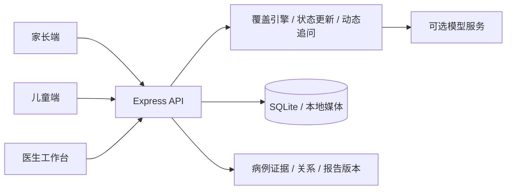

# ChildSys｜儿童青少年心理预问诊系统

ChildSys（项目目录名 ChildPsych）是面向儿童青少年心理初诊场景的研究原型。系统通过家长与儿童分别参与的预问诊，整理主诉、病程、功能影响和安全线索，并在医生工作台汇集可追溯的多来源证据，帮助医生准备面诊。

系统包含家长端、儿童端和医生端，支持语音交互、文字修正、动态追问、录音录像回看、病例关联及报告版本比较。**当前版本用于开发、研究与演示；自动摘要、证据关系和模型输出均需医生核实，尚未完成临床有效性验证。**

## 系统功能

| 模块 | 主要能力 |
| --- | --- |
| 家长端 | 基本资料、知情同意与设备检查；自由口述主诉；结合回答逐轮追问；文字修正；主动停止并生成已采集信息报告 |
| 儿童端 | 独立访谈入口与适龄问句；记录儿童自己的体验、未知与拒答；与家长分别完成访谈 |
| 医生工作台 | 按病例汇集会话和补充材料；查看优先核实内容、结构化摘要、来源差异、时间关系与信息缺口 |
| 证据追溯 | 从摘要跳转到来源、问题、完整回答及高亮原文；结合媒体时间线回看录音录像 |
| 病例与版本管理 | 明确关联或移出会话；补充学校、量表、既往记录及医生材料；保留更正链、报告快照和医生核实记录 |
| 模型辅助 | 动态问题规划与表达；可选的医生端证据抽取、关系候选与医生版摘要；输出校验及规则回退 |
| 访客网关 | 访谈页面免密；医生身份验证；访客会话与录音归属校验；限定病例和角色的签名访谈入口 |

### 初诊信息覆盖

访谈围绕14个领域组织信息：本次主要困扰、具体表现、起始与变化过程、频率与程度、学习生活及关系影响、诱因与近期背景、不同场景与来源、睡眠食欲及躯体情况、发育与健康史、既往求助与干预、家庭及家族情况、当前安全线索、求助诉求、优势与支持资源。

状态评估和问句生成可以分别配置：原规则模式保留原有抽取、判定与目标选择；实时语义模式由模型抽取带原文定位的证据、判断证据要求，并选择下一问或提出结束。服务端校验输出、更新状态，处理用户停止和安全边界；模型提出结束时再调用结束充分性审查。

44个信息字段共用版本化证据契约，原规则的18个必采字段保持不变。语义模式在明确有功能影响时额外激活影响事例。次数与参照时间可跨轮补足，附带披露可同时更新多个字段；未知、拒答和未听懂分别记录。信息已处理与证据已充分分别统计，未知和拒答不会提高证据覆盖率。已有安全规则仍优先执行。

### 多来源证据与独立取证

家长与儿童的会话只在明确关联到同一病例后汇集，不按姓名、年龄或主诉自动合并。系统保留直接来源与转述来源、原始回答、指向时间、观察场景和不确定性；“未观察到”不会自动等同于“没有发生”。支持、补充、更正和分歧等关系作为待核实候选保存，更正后仍保留历史原文。

同病例的其他直接来源可以触发中性领域关注，但另一来源的原话、肯否、频率和程度不传入当前受访者的问题生成上下文。例如，儿童提到睡眠困难时，家长端可以开放询问自己观察到的睡眠情况。由于提问领域受到其他来源影响，这类采集不应称为完全独立验证。实现细节见[跨来源关注与独立取证](docs/跨来源关注与独立取证-2026-10-13.md)。

## 技术架构



- 前端：React 18、Vite 8，包含访谈页面和病例级医生工作台。
- 后端：Node.js、Express 4、better-sqlite3；结构化记录保存在 SQLite，媒体文件单独存储。
- 核心逻辑：JavaScript ES Modules，组织覆盖领域、证据状态、追问策略、关系和报告。
- 模型接入：支持 OpenAI 兼容接口；医生端可单独配置 Ollama，与家长／儿童端模式相互独立。
- 语音：浏览器语音识别与媒体采集；可选 Python `edge-tts` 语音播报，失败时使用浏览器播报回退。

## 快速启动

建议使用 Node.js 22.12 或更高版本，以及支持麦克风、摄像头和语音能力的 Chrome / Edge。Vite 的 Node.js 版本要求为 `^20.19.0 || >=22.12.0`。Python 仅用于可选的神经语音播报。

```powershell
git clone https://github.com/zling77/childSys.git
cd childSys
npm ci
Copy-Item .env.example .env
```

首次体验可先编辑 `.env`，关闭外部模型调用：

```dotenv
PREVISIT_LLM_MODE=off
PREVISIT_STATE_BUILDER_MODE=rule
PREVISIT_CLINICIAN_LLM_MODE=off
PREVISIT_OLLAMA_SSH_HOST=
```

```powershell
npm run dev
```

macOS / Linux 可用 `cp .env.example .env` 复制配置，其余 npm 命令相同。不要直接复制其他操作系统的 `node_modules`，应在本机执行 `npm ci`。

| 入口 | 本地地址 |
| --- | --- |
| 家长端 | http://127.0.0.1:5176/guardian |
| 儿童端 | http://127.0.0.1:5176/child |
| 医生端 | http://127.0.0.1:5176/clinician |
| API 健康检查 | http://127.0.0.1:4176/health |

首次启动会按配置创建本地数据库。医生端可通过演示工具加载合成病例；**重建演示病例会清空当前数据库，不应对需要保留的数据执行。** 建议使用独立的演示数据库。

## 模型与语音配置

`.env.example` 提供配置项示例，真实密钥只写入本地 `.env`。

| 配置项 | 用途 |
| --- | --- |
| `PREVISIT_LLM_MODE` | `off`：关闭追问模型（`rule`状态模式下使用本地规则，`semantic`下等待模型重试）；`shadow`：规则对照与审计；`dynamic`：启用模型决策与问句表达 |
| `PREVISIT_STATE_BUILDER_MODE` | `rule`：原规则对照；`shadow`：原规则状态，语义评估在后台审计；`semantic`：实时语义评估驱动状态。未配置时为 `rule`，示例配置启用 `semantic` |
| `PREVISIT_STATE_MODEL` | 可选证据评估模型，默认使用 `PREVISIT_LLM_MODEL`；共用其服务地址与密钥 |
| `PREVISIT_STATE_TIMEOUT_MS` | 实时证据评估总期限，默认8000毫秒；超时不重试，保存原话和已有证据，不把规则抽取结果冒充语义充分证据 |
| `PREVISIT_STATE_OUTPUT_FORMAT` | `json_object`：兼容原服务；支持JSON Schema的Ollama可用 `json_schema`，使用紧凑输出协议，再转换成统一证据契约，不更换证据判定标准 |
| `PREVISIT_DIALOGUE_AUDIT_MODE` / `PREVISIT_DIALOGUE_AUDIT_EVERY_TURNS` | 默认 `off`；`shadow` 时每N轮及正常结束后异步审计，N默认5。只记录待人工核查的问题，不回写状态；同一局域网模型仍可能有资源竞争 |
| `PREVISIT_LLM_BASE_URL` / `PREVISIT_LLM_API_KEY` | OpenAI 兼容服务地址与密钥 |
| `PREVISIT_LLM_MODEL` / `PREVISIT_LLM_CLARIFY_MODEL` | 信息辅助与逐轮澄清／追问使用的模型；按实际服务支持填写 |
| `PREVISIT_LLM_THINKING` | 支持该字段的服务可设置 `enabled` / `disabled`；其他服务留空 |
| `PREVISIT_LLM_REASONING_EFFORT` | 可选兼容字段；本地Ollama的Qwen 3.8配置为`none`关闭额外思考，未配置时不发送 |
| `PREVISIT_CLINICIAN_LLM_MODE` | 医生端模型链路开关，默认 `off` |
| `PREVISIT_CLINICIAN_LLM_BASE_URL` / `PREVISIT_CLINICIAN_LLM_MODEL` | 医生端 Ollama 地址与模型名 |
| `PREVISIT_OLLAMA_SSH_HOST` | 可选 SSH 隧道主机；不使用远端隧道时留空 |
| `PREVISIT_DB_PATH` / `PREVISIT_MEDIA_ROOT` | 可选数据库及媒体保存路径 |
| `PREVISIT_TTS_PYTHON` | 已安装 `edge-tts` 的 Python 可执行程序或绝对路径 |

使用模型时，将模式改为所需值，配置有效服务地址、模型名和密钥，然后重启。医生端模型报告单独作为研究草稿保存，可与规则报告对照。配置与开发记录见[医生端 LLM 接入与对照](docs/医生端LLM接入与对照-2026-10-09.md)。示例中的模型名和旧服务器名不保证在你的环境中可用。

启用实时算法：设置 `PREVISIT_STATE_BUILDER_MODE=semantic` 和 `PREVISIT_LLM_MODE=dynamic`。LLM 评估证据后，自主决定下一目标、动作、问句或结束；采集字段用于记录和提供证据标准，不要求逐项问完。普通追问不再调用原价值函数，不使用前五候选、固定动作映射、18次调用或24轮终止限制。原价值函数代码保留给规则对照，未修改。状态模式由服务端在创建会话时固定；切换模式后需重启并新建会话。

普通轮次通常一次证据评估和一次决策／问句调用（单次完成Policy、Critic和Realizer）。仅决策输出未通过本地校验时，允许一次LLM自纠正，和首次决策共享8秒总预算；网络错误和超时不自动重试。纠正前输出和原因随审计保留。仍失败时保存原话和已有证据，显示继续按钮，不自动替换成规则问题或结束。`semantic`下关闭动态模型也会等待重试；要使用原本地规则流程，应将状态模式设为`rule`。精确的单句未知／拒答可直接记录，但后续目标仍由LLM决定。安全线索优先走原安全流程。后台`shadow`评估不阻塞返回。以上是调用预算，不代表实测响应时间。

仅当动态LLM提出`complete`时，在写入完成状态前额外调用一次独立结束充分性审查（同一服务、独立prompt，最长8秒且不重试）。审查读取当前会话全部原话和证据状态，判断个案必要信息、可保留未知及补问收益，不要求全部字段填满。通过则沿用原报告流程；需要继续时由审查LLM生成一项补问；审查失败、上下文超预算或无法判断时保留回答并等待重试。支持性结论必须引用本会话逐字原话，审查写入`completion_adequacy_review`审计，不回填充分证据。用户主动结束、暂停及安全流程不受该审查阻拦；拒答目标不能被审查补问重开。多源分析模块未修改。

追问决策附带`context_check`，由同次LLM调用引用原话检查已知内容和拒答范围，不回写证据充分性；程序拒绝与模型自己已知/拒答判断冲突的重复目标。拒答上下文包含原问题与拒答原话。结束审查通过原文片段编号引用证据，程序仅还原对应轮次、原文和字符位置，不补造引用或判定语义充分。输入保留当前来源历史，不读后续多源分析结果。服务未强制执行JSON Schema时，显式JSON格式说明和本地校验仍生效，错误输出不能直接结束。

证据、逐项充分性判断及状态事件随回答在同一事务落库；原话、更正链和模型审计保留。语义模式以 `facet_state_v2` 读取字段状态，旧 `slot_state` 保留兼容投影。评估失败会留下错误审计，当前未充分的信息仍保持缺失。逐字引用和结构校验不能证明模型理解正确，正式实验仍需标注语料评估充分性误判、重复追问率和真实响应时间。

语义模式的证据评估、Policy/Critic和Realizer共用角色、年龄与情绪约束：家长按成人表达并区分观察和转述，儿童保持6—11、12—14、15—18岁分层；未知年龄用中性短句。问句风格不会改变证据字段归属和最低要求。情绪标记区分本人/他人及当前/历史，模型回应与程序兜底在一个位置组装，避免重复安抚。普通情绪不直接升级成已确认的安全信号；模型安全候选保留审计，既有安全模块继续控制路由。

明确拒答只关闭相应内容；明确暂停提问时显示“继续问诊”，不自动索取新内容；明确结束时走原报告流程。暂停提问不暂停原连续音视频录制，页面会在录制中明确提示，可使用原停止按钮结束采集。语义模式允许自然语言问句，不再用字段关键词匹配代替模型语义判断，但仍保留目标集合、角色、格式、来源、安全和重复问题边界。

保留 `rule` 用于比较新方案整体效果、排查模型服务故障和复现实验；它不会在 `semantic` 中把未评估回答自动判为充分。若要分别归因证据评估、角色表达或目标决策的贡献，仍需控制其他因素并另做消融实验。

可选语音播报依赖：

```powershell
python -m pip install -r requirements-tts.txt
```

在 `.env` 中将 `PREVISIT_TTS_PYTHON` 设置为对应 Python 路径。语音识别、摄像头和麦克风还受浏览器支持、授权及 HTTPS / localhost 安全上下文限制。

## 公网访谈网关

普通开发入口用于可信本机或受控网络。**后端医生 API 本身没有完整身份鉴权，不应直接暴露后端端口或 Vite 开发服务。** 公网访问应通过独立网关及 HTTPS，并限制外部直接访问后端。

网关启动前，需创建本地 `server/data/run/cpolar-clinician-access.json`，包含自行设置的非空 `username` 和强 `password`；该凭据文件不进入版本控制。后端运行后执行：

```powershell
npm run build
npm run dev:public
```

网关默认监听 `127.0.0.1:5178`：家长／儿童入口免密，医生页面与管理接口需要 Basic 身份验证；匿名访客只能访问当前浏览器创建的会话及媒体。访客 Cookie 使用 `Secure`，公网入口需 HTTPS。病例邀请有时限并限制病例与角色，清除 Cookie 后原访客会话无法继续由该浏览器访问。

当前网关仍包含原部署域名相关配置，换域名时需检查 `server/public-gateway.mjs`；它是演示访问控制实现，不能代替正式部署所需的身份体系和数据治理。详见[公网免密访谈入口](docs/公网免密访谈入口-2026-10-16.md)。

## 构建与验证

```powershell
npm run build
npm run smoke
npm run acceptance
npm run regression
npm run clinician:regression
npm run clinician:workspace-regression
npm run clinician:llm-regression
npm run server:data-safety-smoke
npm run public:regression
```

`regression` 包含核心流程、访谈契约、模型上下文、动态预算、Provider、持久化、跨来源采集及实时语义状态检查。`npm run semantic:regression` 可单独验证语义单元测试和本地HTTP模型链路，使用临时数据库与受控响应，覆盖跨轮补足、拒答、附带披露、更正、超时、停止竞争以及三种状态模式。医生端和公网网关检查使用专门脚本。测试采用合成材料或受控模型响应，不代表真实模型效果或临床验证。

`npm run communication:regression` 验证年龄边界、情绪对象/时间、拒答范围、协议转换和价值函数未变；`npm run semantic:live-regression` 启动临时后端，使用配置的真实模型与合成家长/儿童语料检查生成、状态及重复追问。真实测试不进入默认回归，最新结果及历史保存在忽略提交的 `output/semantic-live-regression*.json`。跨轮场景使用指定目标验证状态补足，不等同于自然访谈总轮数评估。局部合成用例通过不能代替标注语料或临床有效性验证。

浏览器端到端检查使用 `npm run test:portals`，需安装对应浏览器，并通过 `PLAYWRIGHT_CHROME_PATH` 设置本机 Chrome / Chromium 路径；现有默认路径来自 macOS。`llm:live-smoke`、`llm:dialogue-smoke` 等真实模型检查需另外配置可用模型服务。

## 目录结构

```text
core/                 覆盖引擎、证据状态、关系、追问策略与模型边界
server/               API、SQLite 存储、媒体、医生模型链路与访客网关
web/                  React 页面、医生工作台、语音和媒体交互
scripts/              开发启动、回归与验收脚本
tests/                浏览器端到端检查
docs/                 设计说明、开发记录与测试场景
.env.example          可提交的配置示例
requirements-tts.txt  可选 Python 语音依赖
```

## 数据与使用边界

本仓库仅提交源码、依赖锁定文件、配置示例与开发文档；本地 `.env`、整个 `server/data/`（含备份与访问凭据）、录音录像、`output/`、测试结果、构建产物及依赖目录均已排除。

完成知情同意和设备检查后，访谈可从主诉页开始连续录制音视频，直至正常完成或主动停止。媒体保存在配置的本地媒体目录，数据库保存元数据。启用外部模型或在线语音服务时，相应文本可能发送给服务提供方；演示请使用合成或按要求去标识的数据。

系统保留来源分歧、不确定性与缺失信息，自动关系和模型摘要用于医生核实参考。当前实现不用于自动诊断、治疗决策或替代面诊。真实患者使用前，需要另行完成适用的伦理、知情同意、隐私、权限、存储及部署审查。

详细开发记录见[医生端改造说明](医生端改造说明.md)、[医生端证据与录音工作台改造](docs/医生端证据与录音工作台改造-2026-10-09.md)和[测试场景](docs/portal-test-cases.md)。历史文档中的日期、服务器配置及测试计数对应各自开发阶段，以当前代码和实际验证结果为准。
