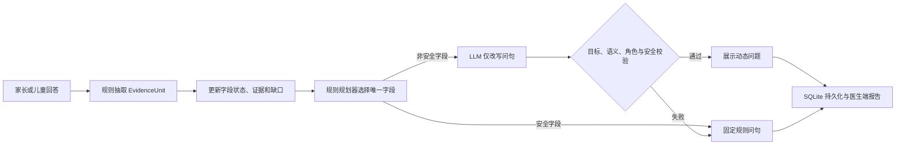

# 动态预问诊改造交付说明

- 交付日期：2026-07-18
- 改造起点：Git 提交 `fc82a26`
- 当前动态 Prompt：`previsit_dynamic_next_question_v4`
- 适用范围：儿童心理行为门诊首诊预问诊

## 1. 本次改造解决了什么

本次改造把动态问诊从“把大量状态交给 LLM，让它决定下一问”，调整为：

> 规则系统负责理解回答、维护字段状态、识别缺口、选择唯一目标和控制安全；LLM 只负责把这个非安全目标改写成一句自然的问题。

因此，14 个首诊信息域不再每轮全部注入 LLM，也不再由 LLM 自行判断问哪个槽位或何时结束。

| 改造前的主要风险 | 改造后的处理 |
| --- | --- |
| 全部槽位、缺口、历史同时进入 Prompt，容易漂移 | 只传规则选定的一个字段及其精简上下文 |
| LLM 可以在多个缺口中自行选择 | 规则规划器唯一选定 `complaintId + slotId + facetId` |
| 槽位只有领域级状态，频率和严重程度可能混在一起 | 14 个领域拆成 18 个必填字段，字段分别保存状态和证据 |
| 安全问题可能被模型改写成不恰当表达 | 安全字段完全禁用模型改写，只使用固定核实问句 |
| JSON 合法但字段为空时仍被当作成功 | schema 或目标不合格会触发重试，最终失败则回退规则问句 |
| 同一轮被不同内容覆盖可能产生“新回答 + 旧证据” | 相同重放为 no-op，不同内容返回 `409 TURN_CONFLICT` |

## 2. 最终运行流程



关键边界：

- 动态模式下，槽位和字段抽取仍由规则完成，不使用 LLM 抽取结果更新正式状态。
- LLM 不选择目标、不修改目标、不判断完成、不生成安全处置。
- 任意模型错误、超时、预算耗尽或边界失败，都保留规则问题，不中断问诊。
- `shadow` 模式中的 LLM 抽取只用于审计对比，不进入正式状态。

## 3. 14 个信息域与 18 个必填字段

14 个信息域现在是确定性的首诊覆盖契约，不是每轮提示词模板。契约共定义 44 个字段，其中 18 个必填字段决定缺口和完成条件，26 个选填字段用于补充信息。

| 信息域 | 含义 | 必填字段 |
| --- | --- | --- |
| `presenting_problem` | 本次主要困扰 | `primary_concern`、`recent_example` |
| `current_manifestations` | 具体表现 | `manifestation_description`、`recent_episode` |
| `onset_course` | 起始与变化过程 | `onset_time`、`course_pattern` |
| `frequency_severity` | 频率、持续与程度 | `frequency`、`severity_example` |
| `functional_impact` | 学习生活与关系影响 | `impact_presence` |
| `triggers_context` | 诱因与近期背景 | `trigger_pattern` |
| `settings_and_sources` | 不同场景与信息来源 | `cross_setting_pattern` |
| `sleep_appetite_physical` | 睡眠、食欲与躯体情况 | `health_change_summary` |
| `development_medical_history` | 发育与躯体健康史 | `development_medical_summary` |
| `prior_help_treatment` | 既往求助与干预 | `help_received` |
| `family_context_history` | 家庭背景与家族情况 | `family_context_summary` |
| `safety_clues` | 当前安全线索 | `current_safety_status` |
| `goals_expectations` | 本次求助诉求 | `priority_goal` |
| `strengths_protective` | 优势与支持资源 | `protective_summary` |

每个领域还可以有选填字段，例如持续时间、受影响领域、既往干预类型、支持者等。选填字段会保存证据和冲突，但不阻塞首诊覆盖完成。

界面和 `progress` 仍按 14 个信息域统计；只有某个域内的全部必填字段都解决后，该域才计为完成。不要把 18 个字段理解为界面进度分母从 14 改成了 18。

## 4. 全部功能改动

### 4.1 契约、抽取和字段状态

- 新增统一的 `intakeContracts`，明确每个领域的：
  - 必填和选填字段；
  - 字段类型；
  - 枚举及归一化策略；
  - 否定表达处理；
  - 单字段尝试次数；
  - 家长端和儿童端固定兜底问句；
  - 完成条件。
- `EvidenceUnit` 会记录命中的 `facetIds` 和各字段自己的 `facetPolarities`。
- 对否定、不确定和混合表达分别处理，例如：
  - “一次都没有”归一化为频率 `0`；
  - “一点影响都没有”归一化为功能影响 `false`；
  - “没有不想活，但是会打自己”保留已确认的自伤事实；
  - “半年前不想活，但现在没有了”区分历史线索和当前否定。
- 修复跨字段污染：
  - “最近一周每天一次”不会误填开始时间；
  - “最严重的一次把门踢坏了”不会误填频率；
  - 当前问题的兄弟字段不能代替目标字段完成。
- 枚举支持确定性归一化；一句话同时命中互斥枚举时标记为 `ambiguous`，不猜测取值。
- 开放文本字段允许保存有实质内容但不包含固定关键词的回答。
- 低置信度新证据不会覆盖更高置信度的已选主值，但仍保留在观察记录中。

字段状态保存在现有 `slot_state.value_json.facets` 中。一个领域可以出现“频率已填、严重程度仍缺失”的状态：

```json
{
  "slotId": "frequency_severity",
  "status": "partial",
  "value": {
    "schemaVersion": "1.0.0",
    "facets": {
      "frequency": {
        "status": "filled",
        "value": "每天一次",
        "polarity": "present",
        "evidenceIds": ["E-..."]
      },
      "severity_example": {
        "status": "missing",
        "value": null,
        "evidenceIds": []
      }
    }
  }
}
```

字段状态支持：`missing`、`partial`、`filled`、`ambiguous`、`conflict`、`declined`、`unavailable`、`not_applicable`。

### 4.2 缺口识别和下一问规划

- `findGaps()` 现在按字段返回缺口，而不是只返回领域。
- 每个缺口包含精确的 `slotId`、`facetId`、状态、优先级、尝试预算和证据 ID。
- 规划器一次只选择一个字段，并记录候选、拒绝原因、选择理由和目标字段。
- 尝试次数按字段累计，旧记录不会被错误复制到同领域的所有兄弟字段。
- 有未关闭安全线索时，安全字段优先。
- 普通字段默认最多尝试 2 次；存在安全线索时安全字段最多核实 3 次。
- 问诊不再因为固定 7 轮而结束；仍保留 24 轮硬安全上限。
- 所有必填字段解决后完成；若剩余字段均达到尝试上限，则结束预问诊并把缺失项留给医生。

### 4.3 动态 LLM Prompt v4

动态 Prompt 不再包含全部槽位、全部缺口、全部候选目标和长对话历史，只包含：

- 回答者角色、年龄、年级；
- 规则选定的唯一字段；
- 当前一问一答；
- 最多 4 条与该字段直接相关的证据；
- 该字段当前存在的冲突；
- 最多 2 轮同字段历史；
- 经过压缩的确定性风险类型和状态。

明确禁止把 `gaps`、`slotStates`、`allSlots`、`allowedTargets` 等宽上下文传入动态 Prompt。

上下文和调用预算：

| 项目 | 限制 |
| --- | --- |
| 编译后的动态上下文 JSON | 最多 4000 字符 |
| 可选相关证据 | 最多 4 条 |
| 同字段历史 | 最多 2 轮、合计最多 1200 字符 |
| 单会话动态逻辑调用 | 最多 18 次 |
| 单次动态模型输出 | 最多 160 tokens |
| 单个问题 | 最多 80 个汉字、一个末尾问号 |

说明：4000 字符限制针对编译后的上下文 JSON，不包含固定 system 指令和输出格式说明。

### 4.4 模型输出边界

模型输出必须满足以下条件，否则使用规则兜底问句：

- `next_action` 必须是 `ask`；
- `complaint_id`、`target_slot_or_issue`、`target_facet_id` 必须与规则目标完全一致；
- 问题语义必须与目标字段一致；
- 家长端使用“您/孩子”，儿童端使用“你”；
- 儿童端不能把被访儿童写成“他/她/患儿/儿子/女儿”；
- 不得包含诊断、风险分层、报警、急诊、用药、治疗或其他处置指令；
- 不得把回答中未出现的行为写成已确认事实；
- 不得重复刚问过的问题；
- 安全字段永远不接受模型改写。

动态模型返回的 `reason` 不再进入策略日志；日志中的选择理由由规则系统生成。

### 4.5 Provider、重试和遥测

- `PREVISIT_LLM_MODE` 只接受 `off`、`shadow`、`dynamic`，拼写错误直接失败，不再误入旧澄清链。
- OpenAI-compatible provider 会对以下问题执行可控重试：
  - HTTP、连接和超时错误；
  - 空响应或非法 JSON；
  - JSON 合法但缺少必填字段；
  - 返回目标与规则目标不一致。
- 多次物理请求的 token 用量会累计，并保存 `request_attempts`。
- 模型审计新增：
  - 上下文纳入和排除项；
  - 字符预算；
  - 逻辑调用预算；
  - provider token usage；
  - 实际请求次数。
- 调用预算按成功或失败的逻辑调用累计；达到 18 次后直接使用规则问题。

### 4.6 安全、回答者角色和情绪承接

- 安全线索继续由确定性规则检测和保存，不做高、中、低风险分层。
- 安全字段在 dynamic 和旧 clarification 两条链路都禁止模型改写。
- 安全问题只核实当前事实，不由模型输出报警、急诊或治疗建议。
- 本轮显式 `speakerRole` 是问句对象的唯一权威来源；仅在调用方未提供时才从 profile 推断。
- 修复 profile 为儿童、实际由家长回答时错误生成儿童问句的问题。
- 情绪承接只在回答者本人明确表达担心、害怕、难受或无法应对时出现。
- “孩子说‘我很难受’”被识别为家长转述儿童原话，不会错误安抚家长。

### 4.7 SQLite 持久化和 API 一致性

新增并验证以下迁移：

| 版本 | 内容 |
| --- | --- |
| v2 | 新增 claim、claim event、字段状态和状态事件表骨架 |
| v3 | `model_audit_log.telemetry_json`，保存上下文和 provider usage |
| v4 | `dialogue_turn.target_facet_id`，保存本轮精确目标字段 |
| v5 | `next_question_decision_log.target_facet_id`，并从旧 JSON 尝试回填 |

启动时会校验关键表、字段和外键；迁移记录与实际 schema 不一致时直接报错，避免静默带病运行。

同轮一致性策略：

- 相同会话、相同轮次、相同内容再次写入：视为幂等重放，不重复写入。
- 相同轮次但内容不同：返回 `409 TURN_CONFLICT`，不覆盖原回答和原证据。
- 前端提交 `expectedTurnNo`，过期页面或迟到的重复请求会被拒绝。

当前正式读写路径仍是：

- `evidence_unit.value_json` 保存字段 ID 和字段极性；
- `slot_state.value_json.facets` 保存字段状态；
- `dialogue_turn` 和 `next_question_decision_log` 保存精确目标字段。

v2 的 `evidence_claim`、`evidence_claim_event`、`facet_state_v2`、`interview_state_event` 当前是后续 claim 级双写所需的 schema 骨架，不是现阶段 snapshot 的正式读取来源。

### 4.8 医生端 PrevisitPacket

- 报告新增 `intake_contract_version`，便于识别生成时使用的字段契约版本。
- 报告按字段读取值，保留分轮采集的频率、严重程度等信息，不再只保留领域最后一次文本。
- 每个领域输出 `facet_values`；每项包含字段 ID、标签、状态、原始值、归一化值、极性和证据 ID。
- 证据行新增 `facet_ids`，缺失项新增 `facet_id` 和 `facet_label`。
- 可选字段发生 `ambiguous` 或 `conflict` 时也会进入医生端冲突列表。
- `open_issues` 使用“信息域 / 字段”的形式显示精确缺口。
- 正常睡眠、正常食欲和无特殊发育史不再被误列为“重要异常”。
- 真正报告的睡眠、躯体或发育变化会进入重要异常。
- 儿童本人回答的报告明确标记为儿童自述。
- 证据来源、时间范围、否定和不确定性继续保留，报告不输出诊断、风险等级或治疗建议。

## 5. 文件改动清单

### 核心问诊逻辑

- `core/intakeContracts.mjs`：新增 14 域/字段契约。
- `core/extractor.mjs`：字段级抽取、极性、相关性和反污染规则。
- `core/state.mjs`：字段状态、归一化、冲突、缺口和旧状态兼容。
- `core/planner.mjs`：字段级候选、尝试次数、安全优先和终止逻辑。
- `core/question.mjs`：字段固定问句、角色一致性和澄清问句。
- `core/orchestrator.mjs`：贯通 `speakerRole`、`targetFacetId` 和字段状态。
- `core/packet.mjs`：医生端字段值、冲突和重要异常输出。

### LLM 动态链路

- `core/llm/contextCompiler.mjs`：新增单字段上下文编译器和预算遥测。
- `core/llm/promptRegistry.mjs`：新增并启用动态 Prompt v4。
- `core/llm/dynamicBoundary.mjs`：目标、字段语义、角色、安全与处置边界。
- `core/llm/schemaValidator.mjs`：动态输出清洗、单问句和长度限制。
- `core/llm/provider.mjs`：模式校验、18 次逻辑预算和审计数据。
- `core/llm/openaiCompatibleProvider.mjs`：schema 重试、160 tokens 和 usage 累计。
- `core/llm/mockProvider.mjs`：补齐字段级动态输出，支持测试。

### 服务、数据库和前端

- `server/index.mjs`：单字段上下文、动态回退、安全禁用、情绪归因和 409 冲突处理。
- `server/store.mjs`：v2-v5 迁移、精确字段持久化、schema 校验和同轮幂等。
- `web/src/main.jsx`：提交 `expectedTurnNo`，阻止迟到请求覆盖新状态。
- `package.json`：把新增契约、上下文、预算和持久化检查纳入 `npm run regression`。

除提交轮次保护外，本次没有调整前端页面结构或视觉样式。

### 测试与验证脚本

- `scripts/core-regression.mjs`：扩充到 56 项核心反例。
- `scripts/test-intake-contracts.mjs`：新增 14 域/18 必填字段契约检查。
- `scripts/context-compiler-smoke.mjs`：新增上下文裁剪、预算、禁止字段和风险压缩检查。
- `scripts/dynamic-budget-smoke.mjs`：新增 18 次逻辑调用预算检查。
- `scripts/facet-persistence-smoke.mjs`：新增字段状态跨数据库重载检查。
- `scripts/persistence-v2-smoke.mjs`：新增 v2-v5 迁移、外键、幂等和字段持久化检查。
- `scripts/llm-provider-smoke.mjs`：新增 schema 重试、usage 累计和 mode 校验。
- `scripts/llm-dialogue-smoke.mjs`：新增动态对话、情绪承接和儿童原话归因检查。
- `scripts/llm-live-smoke.mjs`：更新为精确字段和 Prompt v4 断言。
- `scripts/server-data-safety-smoke.mjs`：新增过期轮次 409 检查。

## 6. 验证结果

本次交付已通过：

| 命令 | 结果 |
| --- | --- |
| `npm run regression` | 56 项核心回归，以及契约、上下文、预算、provider、字段持久化和 v2-v5 迁移检查全部通过 |
| `npm run smoke` | 通过 |
| `npm run acceptance` | 6 个演示场景通过 |
| `npm run server:data-safety-smoke` | 通过 |
| `npm run build` | 前端生产构建通过 |
| `npm run llm:shadow-smoke` | 通过 |
| `PREVISIT_LLM_PROVIDER=mock` 下的 `npm run llm:dialogue-smoke` | 通过 |
| 全部 `.mjs` 的 `node --check` | 通过 |
| `git diff --check` | 通过 |

此外，三路独立只读审查分别检查了：

- 动态模型目标、安全、角色、语义和重试边界；
- 状态、同轮重放、数据库迁移和精确字段历史；
- Prompt 上下文、14 域/18 字段对齐和预算。

审查发现的反例均已补充测试并关闭。

## 7. 当前边界和后续工作

### 已完成

- 14 域/18 必填字段契约和正式字段级状态；
- 规则选目标、LLM 单字段改写；
- 安全字段固定规则问句；
- 上下文、输出和调用预算；
- 精确字段持久化和同轮冲突保护；
- 医生端字段级报告；
- 7B 友好的短 Prompt，同时保持模型无关。

### 暂未包含

- 不使用 LLM 作为动态模式的正式槽位抽取器；
- v2 claim/event 表尚未接入正式双写；
- 未新增诊断、鉴别诊断、风险分级、治疗或药物建议；
- 未实现新的风险关闭生命周期；
- 未完成真实 72B 模型的端到端性能和质量验证。

当前本地 `.env` 配置仍为 `qwen2.5:7b`，本地模型服务此前返回 `fetch failed`。因此可以确认 OpenAI-compatible 接口和 72B 配置路径兼容，但不能宣称已经完成 72B 真机验证。

后续接入 72B 时无需改变问诊状态机，只需：

1. 配置新的 `PREVISIT_LLM_BASE_URL`、`PREVISIT_LLM_MODEL` 和可选 `PREVISIT_LLM_CLARIFY_MODEL`；
2. 保持 `dynamic` 模式和现有 160-token 输出限制；
3. 运行 `npm run llm:provider-smoke` 与 `npm run llm:live-smoke`；
4. 使用同一组 56 项回归和真实脱敏对话集比较 7B/72B 的接受率、回退率、延迟和 token 成本。

## 8. 交付结论

本次改造已经解决最初提出的三个核心问题：

1. **Prompt 内容过多**：14 域不再整包注入，动态上下文只围绕一个规则字段。
2. **缺口如何采集**：正式缺口来自规则抽取和字段状态，不依赖 LLM 自报。
3. **缺口如何保存和传入模型**：缺口以字段级数据结构持久化；LLM 每轮只收到当前唯一字段，不接收全部缺口。

最终架构可以同时服务 7B 和后续 72B：小模型不会被迫承担状态机工作，大模型也不能越过确定性的字段、安全和完成边界。
