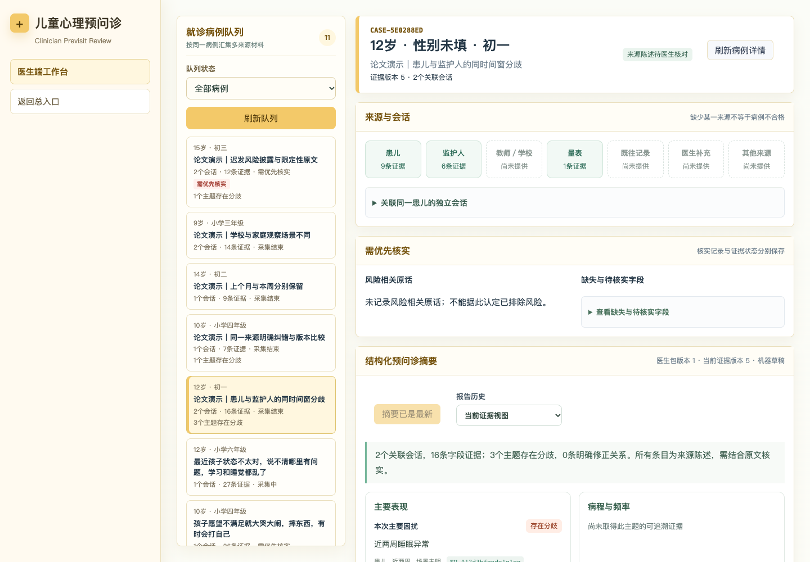
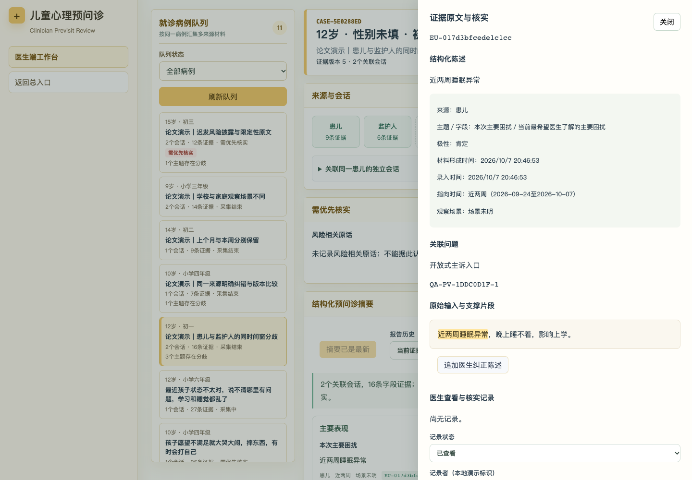

# ChildPsych 医生端改造说明

交付日期：2026-10-07  
基准源码：`/Users/linn/Downloads/ChildPsych/`  
修改后的项目：`ChildPsych-医生端改造-20261007/`

## 本轮完成的内容

本轮把医生端从按单个会话查阅摘要，扩展为按同一就诊病例汇集来源材料、保存证据关系、查看修正过程、逐条追溯原文及记录医生核实的研究原型。

原文件夹没有修改。本副本保留家长端、儿童端和原有会话 API，并在其上增加病例层。交付包包含修改后的源代码、锁定依赖文件、运行说明及测试，不包含原文件夹中的 `.env`、数据库、录音录像、旧交付包或依赖目录。

**本轮新增证据抽取和关系判定使用保守的确定性规则，报告由结构化数据组织生成。它不是已经验证的 LLM 关系识别算法，也不是临床有效性结果。** 原有 LLM 动态追问和影子审计链路保留。论文中的 LLM 抽取／关系初判、独立标注、基线比较及医生可用性研究，仍须独立开展。

## 一 按优先级落实的修改

| 顺序 | 修改 | 已实现的行为 |
|---|---|---|
| 1 | 病例关联与多源汇集 | 每个新会话自动拥有病例编号；医生明确确认同一患儿及本次就诊后，可关联独立家长／儿童会话；关联也可撤回，恢复成独立病例 |
| 2 | 独立证据关系与修正链 | 持久化证据对、有方向的修正边、语义关系、时间关系和判断依据；原文及历史节点保留 |
| 3 | 分歧保留在主线摘要 | 分歧和待核实主题继续显示在摘要中，逐来源并列呈现，不因状态为冲突而从主要条目中消失 |
| 4 | 摘要逐条追溯 | 每条摘要提供来源、指向时间和可点击证据编号；侧面板展示关联提问、完整输入及精确高亮的支撑片段 |
| 5 | 更新与报告历史 | 证据版本和报告版本分别管理；保存报告快照，比较新增证据、修正标记、新关系、核实记录及关联范围变化 |
| 6 | 医生查看、核实和补充 | 证据、风险线索、字段问题和关系均可记录“已查看”“需补充”“已记录核实结果”；核实结果需要填写依据／备注；医生可追加材料或明确指定纠正目标 |

### 1 病例关联

- 队列以 `caseId` 汇集本次就诊材料，保留每个来源会话的 `sessionId`、QA ID 和局部轮次。
- 不使用年龄、性别、年级或文本相似度自动合并患者。
- 医生关联操作要求勾选“已确认属于同一患儿及本次就诊”。该勾选是本地操作确认，不代表已经实现医院身份核验。
- 关联另一会话时，所有来源输入仍使用各自原始 ID；两份会话的“第1轮”不会互相覆盖。
- “移出本病例”把会话恢复到新的独立病例；已有报告快照与历史引用继续保留，当前病例标明关联范围的变化。
- 学校、量表、既往记录及医生材料通过文本录入接入。尚未提供的来源明确显示，不要求每例具备所有来源。
- 区分材料提供者与被转述来源。例如监护人转述学校反馈，仍显示为“监护人（转述教师／学校）”，不会算成学校直接提供。

### 2 证据与关系

新增医生端证据模型版本：`clinician-evidence-1.0-working`。这是项目工作版本，不代表论文 Schema 或 W03 标签已经冻结。

每条字段证据保存：

- 病例、会话或材料标识；
- 来源角色、提供渠道、直接／转述方式；
- 进入轮次、录入时间、陈述／材料形成时间；
- 证据指向时间的原文、可可靠解析的起止范围及时间确定性；
- 主题、字段、观察场景、陈述及极性；
- 风险线索标记；
- 支撑原文、完整输入、QA／材料引用和字符起止位置。

规则按字段和分句形成证据。不能可靠拆分时保留字段原文，不声称已经完成通用的语义原子化抽取。

语义关系与时间关系分别记录：

| 维度 | 当前候选标签 |
|---|---|
| 语义 | `supports`、`supplements`、`corrects`、`contradicts`、`not_comparable`、`unknown` |
| 时间 | `before`、`after`、`same_window`、`overlaps`、`contains`、`contained_by`、`unknown` |

具体约束：

- 不同时间窗的相反描述分别保留，不自动判为冲突，也不据此判断改善／恶化。
- 同一命题、字段和重叠时间窗中的相反极性形成分歧候选。
- 时间不明时，保留可能分歧及未决原因。
- 家庭与学校的明确场景差异，不自动当作冲突。
- “未观察到”不自动等同于对患儿主观体验的否定。
- 同一提供渠道的明确纠错，可记录先前证据到后续证据的修正边；普通后续披露或其他来源的相反说法，不自动当作修正。
- 医生指定纠正目标时，验证目标属于当前病例且主题／字段、命题和范围可比较；不合格的纠正请求会拒绝保存并说明原因。
- 修正后保留旧证据，旧节点标为修正历史；不会删除原话。
- 所有自动关系均为系统候选，仍需核实。未实现来源可信度排序。

### 3 摘要与医生界面

界面现按以下顺序组织：患者概览、来源与会话、优先核实、结构化摘要、来源差异与时序变化、主题证据状态、材料补充、版本历史、采集过程明细及已有媒体附件。

摘要包括主要表现、病程与频率、功能影响、诱因与背景；睡眠／躯体／发育史、既往求助与干预、求助目标与支持资源默认折叠。分歧主题同时显示双方原话及来源。重复字段引用在摘要中适当合并展示，完整证据仍可在明细表查阅。

缺失与待核实字段默认折叠，区分未记录定向询问、已问但未取得可用证据，以及已有会话记录的拒答、不可获得或不适用；相反陈述或不确定信息也进入待核实列表。

“采集覆盖”与“医生核实”分开显示。已采集、已查看或已记录核实结果，均不等于系统确认临床结论。

风险原话保留完整输入中的限定性上下文。医生记录查看／核实结果不会自动关闭风险提示，历史风险陈述也不因纠正而静默消失。

### 4 版本和反馈闭环

- 当前证据可以预览；尚未保存为报告时有明确提示。
- 正常采集结束或主动停止时，服务自动保存病例报告；医生点击生成／更新摘要也可保存当前快照。内容未变时复用原版本，不制造空版本。
- 当前证据版本与已保存报告版本分别显示。
- 查看历史报告时，摘要、关系、证据和核实记录使用该快照的数据；历史视图禁用核实与材料操作。
- 比较两个报告版本可查看新增／移出当前关联范围的证据、修正标记变化、新关系和新增核实记录。
- 保存医生备注会增加当前证据记录版本；更新报告后可在版本比较中查看这次人工记录。
- 核实备注独立保存；需要改变证据陈述时追加材料，不直接改写原话。
- 队列自动刷新保留所选病例。后台有新证据时提示载入最新详情，避免把队列刷新说成全部明细已实时更新。
- 切换病例及报告版本时对异步响应进行核对，防止迟到的请求覆盖新选择。
- 服务连接状态根据实际病例 API 请求结果显示。

## 二 关键文件

| 文件 | 作用 |
|---|---|
| `core/evidenceGraph.mjs` | 证据分句与字段映射、来源和时间表示、候选关系、主题状态、修正边、报告内容与版本差异 |
| `server/clinician-store.mjs` | 病例关联、材料、证据／关系、事件、核实记录及报告快照的持久化 |
| `server/research-demo-cases.mjs` | 5个完全模拟的论文开发演示病例 |
| `web/src/ClinicianWorkbench.jsx` | 新医生工作台，实际由 `/clinician` 挂载 |
| `web/src/clinician.css` | 医生端布局、来源标签、关系对照、原文侧面板及窄屏样式 |
| `core/state.mjs` | 原有采集状态更新加入时间范围与明确纠错的处理，保留历史观察 |
| `core/packet.mjs` | 原会话报告也保留冲突／不明确主题及双方描述 |
| `server/store.mjs` | 创建会话时关联病例；兼容原数据；重置时清理新增病例数据 |
| `server/index.mjs` | 新病例 API；原会话返回病例编号；演示入口同时生成研究开发病例 |
| `web/src/main.jsx` | 医生入口挂载新工作台；旧医生组件作为未挂载的兼容代码保留 |
| `scripts/clinician-regression.mjs` | 32项新增语义边界、持久化及版本检查 |
| `tests/e2e/clinician.spec.mjs` | 5项新增医生浏览器场景 |
| `tests/e2e/portals.spec.mjs` | 更新医生用例适配病例 API；修正原语音测试的过时预期与启动时序 |
| `scripts/server-data-safety-smoke.mjs` | 直接对照确定性引擎的问题字段验证 shadow 模式，替代已过时的固定策略名称断言 |

新增表：`clinical_case`、`case_session`、`case_material`、`case_evidence`、`case_relation`、`case_state_event`、`clinician_review`、`case_packet`。

打开旧数据库时，在保留原会话、证据与报告的基础上，为未关联会话建立病例层。不自动合并旧病例。本轮验收用临时数据库验证了创建、关联、持久化、重新打开和重置；没有复制或运行用户原数据库。

主要新 API 的前缀为 `/api/previsit/clinician`：

| 方法及路径 | 用途 |
|---|---|
| `GET /cases` | 病例队列 |
| `GET /sessions` | 可明确关联的会话 |
| `GET /contracts` | 材料录入主题／字段 |
| `GET /cases/:caseId` | 当前证据、报告、材料、核实记录及事件 |
| `POST /cases/:caseId/sessions` | 关联会话 |
| `POST /cases/:caseId/sessions/:sessionId/detach` | 将会话恢复为独立病例 |
| `POST /cases/:caseId/materials` | 添加来源材料／医生纠正陈述 |
| `POST /cases/:caseId/reviews` | 记录查看、待补充或核实结果 |
| `POST /cases/:caseId/packet` | 保存／更新报告快照 |
| `GET /cases/:caseId/packets/:version` | 读取历史报告 |
| `GET /cases/:caseId/compare?from=1&to=2` | 比较报告版本 |

## 三 如何运行与演示

使用与锁定依赖兼容的 Node.js；当前 Vite 包声明支持 Node `^20.19.0 || >=22.12.0`。建议在目标机器上安装依赖，不跨操作系统复制 `node_modules`，尤其是 `better-sqlite3` 原生模块。

在项目目录中执行：

```bash
npm ci
PREVISIT_LLM_MODE=off npm run dev
```

医生端入口：[http://127.0.0.1:5176/clinician](http://127.0.0.1:5176/clinician)。上述离线 LLM 模式即可演示医生功能，不需要真实 API key。若启用原动态追问，则按 `.env.example` 在本地配置 `.env`；本轮没有复制原密钥，也没有调用真实模型 API。

展开左侧“演示数据工具”，点击“生成演示病例”。**该按钮会清空当前副本数据库及其关联媒体，再创建6个原有体验病例和5个论文开发病例。** 界面已显示这一行为。若副本后续已有需要保留的数据，不要使用重建按钮。

推荐按顺序查看5个新增病例：

| 病例 | 可演示内容 |
|---|---|
| 患儿与监护人的同时间窗分歧 | 独立会话汇集、双方陈述、量表来源、摘要中的分歧保留 |
| 同一来源明确纠错与版本比较 | 两个报告版本、旧原文保留、有方向的修正关系 |
| 上个月与本周分别保留 | 不同时间窗不误判冲突；既往记录作为独立来源 |
| 学校与家庭观察场景不同 | 学校反馈、家庭描述与情境差异分别保留 |
| 迟发风险披露与限定性原文 | 前期否认和后续披露同时保留；点击原文查看“但没有采取行动”等上下文；记录核实后仍保留风险线索 |

新增5例均为完全模拟数据，年龄9–15岁，位于暂定6–17岁操作范围内。原有6例是兼容体验材料，其中有5岁病例，不计入本轮论文开发集。两组都不属于临床数据、独立人工金标准或实验有效性证据。

## 四 验收结果

以下为本轮实际运行的结果：

| 检查 | 结果 |
|---|---|
| 前端生产构建 `npm run build` | 通过 |
| 原核心回归 | 59项通过 |
| 新医生证据／持久化回归 `npm run clinician:regression` | 32项通过 |
| 完整原回归 `npm run regression` | 通过，包括14域契约、上下文编译、动态预算、LLM mock provider、字段及v2–v5持久化检查 |
| 浏览器端到端 `npm run test:portals` | Chrome上12项通过，含5项新增医生用例和7项三端用例 |
| 原演示病例验收 `npm run acceptance` | 6例通过 |
| 服务数据／媒体安全检查 `npm run server:data-safety-smoke` | 通过 |

32项新增检查覆盖了不同时间窗、同时间窗分歧、未知时间、不同场景、未观察到与主观体验、明确纠错、跨来源反例、同轮补充不能误修正、摘要冲突保留、原文位置、独立会话、关系持久化、版本幂等、历史比较、风险上下文、核实记录、转述来源、医生纠正校验、非法输入、无效日历日期、移出会话、数据库重开和重置。

浏览器检查验证了真实页面上的原文高亮、核实记录、版本比较、会话关联、材料录入、新证据通知和390像素窄屏。语音与摄像头使用测试 mock；没有据此声称真实设备、神经TTS服务器或真实模型 API 已验收。

首次浏览器检查发现了材料表单标签和折叠内容定位问题，已修正并重新通过。原语音测试还包含两项过时假设：失败后必须改用旧本地声音、输入前播报计时已结束。已按当前 `tts.js`／`useNarration.js` 的首选声音重试及实际播报结束条件更新测试断言，保留错误后重试次数和成功完成检查；这两个语音产品文件没有修改。原服务数据检查的固定 `rule_clarify` 名称断言也已改为与当前确定性引擎逐字段比较，仍严格检查 shadow 模式没有替换正式问题。

## 五 当前边界与后续研究

- 本轮完成医生端证据状态原型的连接与操作流程，尚未完成论文方法的临床或算法有效性验证。
- 关系判断是规则候选，通用语义、精细数量比较、复杂指代、复杂时间范围及隐喻表达仍需验证；系统在不足时保留未知，不强行输出可信度排序。
- 修正链按有向证据边保存，未实现复杂图可视化或完整病程推断。
- `caseId`用于明确关联本次就诊材料，尚未建立医院患者主索引或跨次随访档案。
- 学校、量表、既往病历目前为文本录入；未新增PDF／图片OCR、医院病历接口或自动量表解释。
- 医生核实记录是本地演示标识，未实现医生登录、角色权限、电子签名或正式病历签署。
- 风险标记仅供核实，没有风险分级、自动分诊或自动危机处置；未出现风险原话不能解释为排除风险。
- 音视频仍为原始附件回放，未实现表情／声学分析或每条证据的媒体片段定位。
- 尚未做大规模病例队列的性能、并发或真实临床工作流研究。
- 后续论文评价应固定病例与界面条件，对照普通摘要、RAG摘要和无状态抽取，分别测量关系质量、错误覆盖、分歧保留、修正边／链、追溯正确性及医生使用表现，避免把界面改进当作算法收益。

## 六 可用于本次工作汇报的表述

> 已完成ChildPsych医生端的病例级证据工作台改造，支持独立家长／儿童会话的明确关联、多来源文本材料接入、语义与时间关系候选的独立记录、分歧摘要呈现、明确纠错链保留、逐条原文高亮追溯、报告历史与版本比较，以及医生查看、核实和补充记录。已新增5个完全模拟的论文开发演示病例，并通过本轮核心、持久化及浏览器功能检查。当前关系识别与输出仍是确定性规则原型，后续需接入和评价论文所设计的LLM语义执行组件，并通过独立标注、基线实验和医生评价验证方法价值。

## 七 页面预览

以下截图均来自本次修改后的本地页面，使用完全模拟材料。




